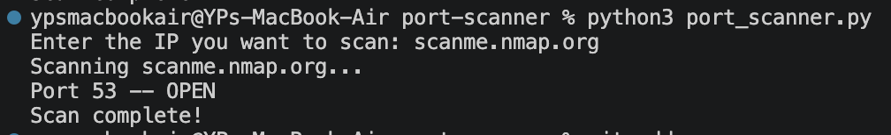

# Port Scanner

A multi-threaded Python port scanner I built as a hands-on exercise in network reconnaissance fundamentals - covering socket programming, concurrent I/O, and ethical scanning practice.

## What it does
Built to understand how attackers perform network reconnaissance as the first stage of the Cyber Kill Chain and how defenders can detect and block it.

## Prerequisites
- Python 3.9+
- Standard library only (no external dependencies)

## How it works
Uses Python's `socket` library to attempt a connection to each port. If the connection succeeds, the port is open. To make it fast, I used `threading` so multiple ports get scanned at the same time instead of one by one.

## How to run
python3 port_scanner.py
Then enter the IP you want to scan when prompted.

## Sample Output
- Enter the IP you want to scan: scanme.nmap.org
- Scanning scanme.nmap.org...
- Port 53 -- OPEN
- Scan complete!

## Demo

## Challenges I faced
The first version scanned ports one by one and was painfully slow : 1024 ports could take several minutes. I fixed this by adding threading so all ports are scanned in parallel. Massive speed improvement.

## What I learned
- How sockets work for network connections in Python
- Why timeouts matter (otherwise the scanner hangs on closed ports)
- How threading can speed up I/O bound tasks

## Tested on
scanme.nmap.org : a server provided by Nmap for legal scan practice.

## CSV Export
Each scan generates a CSV report with timestamp, target IP, port number, and status — for easy record-keeping across multiple scans.

## Future improvements
- Add banner grabbing to detect what service and version is running on each open port
